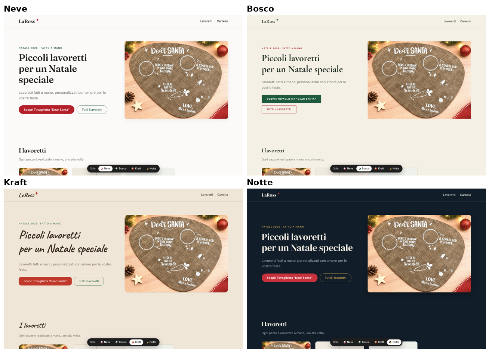

# Le Perle di Ross – negozio di lavoretti fatti a mano

Sito minimal per vendere lavoretti: catalogo, pagina dedicata per ogni lavoretto
(con campo di personalizzazione, es. i nomi sulla tovaglietta), carrello con
indirizzo di spedizione, pagamento con PayPal (anche carta senza account) e
un'area riservata dove vedere e gestire gli ordini.



## Provare la demo in HTML

`demo/index.html` è una versione di prova in un unico file, nello stile Neve:
basta aprirlo con un doppio clic nel browser (anche dal telefono). Il pagamento è
simulato e gli ordini restano salvati solo in quel browser; c'è anche l'area
ordini (`#ordini`) per vedere come appaiono le richieste ricevute.

Per pubblicarla gratis con GitHub Pages: nelle impostazioni del repository →
*Pages* → scegli il branch e la cartella `/demo` non è supportata direttamente,
quindi seleziona la radice e apri `https://<utente>.github.io/<repo>/demo/`.

## Avvio

Serve Node.js 20.12 o più recente.

```bash
npm install
cp .env.example .env     # poi apri .env e compila i valori
npm start                # http://localhost:3000
```

Senza credenziali PayPal il sito parte in **modalità prova**: al posto dei
pulsanti PayPal c'è "Paga (simulazione)", così puoi provare tutto il percorso.

## Le alternative di stile

Ci sono 4 stili, tutti con pulsanti nei colori del Natale:

| Stile   | Atmosfera                                   |
|---------|---------------------------------------------|
| `neve`  | Bianco pulito, pulsanti rosso Natale        |
| `bosco` | Crema e verde abete, pulsanti verdi         |
| `kraft` | Carta da pacchi e titoli scritti a mano     |
| `notte` | Blu notte, pulsanti rossi e dettagli oro    |

Mentre scegli, in basso c'è una barra per passare da uno stile all'altro
(oppure aggiungi `?tema=kraft` a un indirizzo). Quando hai deciso, in `.env`:

```
TEMA=kraft
MOSTRA_SCELTA_TEMA=false
```

## Aggiungere o modificare i lavoretti

I lavoretti sono nel file `data/prodotti.json` (le modifiche si vedono subito,
senza riavviare). Le foto vanno in `public/img/`. Esempio:

```jsonc
{
  "slug": "tovaglietta-dear-santa",          // indirizzo: /lavoretti/tovaglietta-dear-santa
  "nome": "Tovaglietta “Dear Santa”",
  "sottotitolo": "…",
  "prezzo": 15.00,
  "immagini": ["/img/tovaglietta-dear-santa.jpg"],   // più foto = galleria
  "descrizione": "…",
  "dettagli": ["…", "…"],
  "personalizzazione": {                     // facoltativo
    "etichetta": "Nomi da scrivere sotto “Love,”",
    "esempio": "Alice e Lavinia",
    "maxLunghezza": 40,
    "obbligatoria": true
  },
  "tempiDiLavorazione": "Pronta in 3–5 giorni lavorativi",
  "disponibile": true,                       // false = nascosto dal catalogo
  "inEvidenza": true                         // mostrato in alto nella home
}
```

> La pallina e i segnaposto sono **prodotti di esempio**: sostituiscili con i tuoi.
> Anche prezzo e dimensioni della tovaglietta sono da verificare.

## Vedere gli ordini

Vai su `/admin` (utente `admin`, password = `ADMIN_PASSWORD` in `.env`).

- **Da spedire**: ordini pagati, con cosa realizzare e il testo da personalizzare
- Dettaglio ordine: indirizzo pronto da copiare sull'etichetta, email e telefono
- "Segna come spedito" (con numero di tracking facoltativo), "Annulla ordine"
- **Scarica CSV**: tutti gli ordini, apribile con Excel

Gli ordini sono salvati in `storage/ordini.json`: fanne una copia ogni tanto.

## Attivare PayPal

1. Vai su <https://developer.paypal.com/dashboard/applications>, accedi con il
   conto PayPal (meglio un conto **Business**, gratuito) e crea un'app.
2. Copia *Client ID* e *Secret* della scheda **Sandbox** in `.env` con
   `PAYPAL_ENV=sandbox` e prova un acquisto con un account di test sandbox.
3. Quando funziona, usa le credenziali della scheda **Live** e `PAYPAL_ENV=live`.

Il prezzo viene sempre ricalcolato sul server dal catalogo: il cliente non può
modificarlo. L'ordine diventa "Pagato" solo dopo la conferma di PayPal.

## Pubblicare online

Serve un hosting che esegua Node.js e mantenga i file su disco (per
`storage/ordini.json`), ad esempio un piccolo VPS, Render/Railway con un disco
persistente, o un hosting Node condiviso. Imposta `NODE_ENV=production`, una
`ADMIN_PASSWORD` robusta e usa HTTPS. In produzione la modalità prova è
disattivata e senza PayPal configurato non si accettano ordini.

Prima di vendere ricorda di aggiungere le pagine legali (informativa privacy,
condizioni di vendita / diritto di recesso) adatte alla tua attività.

## Struttura

```
server.js            pagine e API ordini
lib/views.js         HTML delle pagine + elenco degli stili
lib/admin.js         area ordini
lib/paypal.js        collegamento a PayPal
lib/store.js         lettura/scrittura prodotti e ordini
data/prodotti.json   catalogo
public/              css, js, immagini
```
